# Complete Project Mind Map

This document provides a holistic, hierarchical Mermaid mind map of the **Organizational Knowledge Gap Intelligence Platform**, mapping every business goal, frontend component, backend controller, service engine, database entity, machine learning model, user role, and test suite directly to its underlying source file.

---

## 1. Complete System Mind Map (Mermaid)

```mermaid
mindmap
  root((Knowledge Gap Platform))
    Platform Purpose
      Objective Competency Evaluation
      Weighted Skill Gap Analysis
      Dynamic Peer Mentoring
      Personalized Learning Pathways
      ML Training Outcome Prediction
      Enterprise Identity Governance
    Frontend Application (React 18 + Vite)
      Authentication & Layout
        LoginPage.jsx (Demo Quick Fill)
        AuthContext.jsx (JWT State & Role Flags)
        Navbar.jsx (Role Badges & Profile)
        Sidebar.jsx (Dynamic Navigation Links)
        ProtectedRoute.jsx (RBAC Guard)
      Employee Workspace
        EmployeeDashboard.jsx
        SkillGapPage.jsx (Radar Chart)
        AssessmentCatalogPage.jsx
        AssessmentQuizPage.jsx (Interactive Quiz)
        CourseRecommendationsPage.jsx
        LearningPathPage.jsx (Milestone Tracker)
        MentorshipPage.jsx (Recommendations)
      Mentor Workspace
        MentorDashboard.jsx (Advisory Hub)
        Assigned Mentees Panel
        Mentee Progress Inspector
        1-on-1 Session Logger (LocalStorage)
        Availability Modal
      Manager Workspace
        ManagerDashboard.jsx (Dept KPIs)
        TeamReadinessPage.jsx
        MentorApprovalPage.jsx (Approve/Reject)
        TeamPathwaysPage.jsx
      Admin Workspace
        AdminDashboard.jsx (Safe users.reduce)
        UserManagementPage.jsx (Provisioning)
        CatalogsPage.jsx (Courses & Quizzes)
    Backend Tier (Spring Boot 3.3.4 / Java 21)
      REST Controllers
        AuthController (/api/v1/auth)
        SkillGapController (/api/v1/skills/gaps)
        MentorshipController (/api/v1/mentorship)
        AssessmentController (/api/v1/assessments)
        CourseController (/api/v1/courses)
        LearningPathController (/api/v1/learning-paths)
        MlPredictionController (/api/v1/ml)
        AdminUserController (/api/v1/admin/users)
      Service Engines
        UserService.java
        SkillGapService.java (Weighted Gap Formula)
        MentorMatchingService.java (Capacity-Aware)
        MentorAssignmentService.java (Approval Workflow)
        AssessmentService.java (Safe Delivery & Grading)
        CourseRecommendationService.java
        LearningPathService.java
        MlPredictionService.java (FastAPI Client)
      Security & Authorization
        SecurityConfig.java (Stateless JWT)
        JwtTokenProvider.java (HMAC-SHA256)
        JwtAuthenticationFilter.java
        CustomUserDetailsService.java
        SecurityUtils.java (Dept Boundary Logic)
    Persistence Tier (PostgreSQL 15/16)
      Flyway Migrations
        V1__init_schema.sql (15 Tables)
        V2__seed_dev_data.sql (Dev Seed Data)
        V3__add_mentor_role.sql (MENTOR Role)
        V4__update_mentor_profile_capacity.sql
      Core Entities
        users (ID, email, password_hash, role)
        departments (ENG, DAI, PRD)
        job_roles (Junior SWE, Senior SWE, ML Eng)
        employee_profiles (Capacity, Opt-in, Hours)
        skills & skill_categories
        job_role_skills (Weights: 3.0 Mandatory, 2.0 Core)
        employee_skills (Verified Level)
        assessments & assessment_questions (JSONB)
        assessment_submissions (Scores & History)
        courses & course_skills
        learning_paths & learning_path_courses
        mentor_assignments (ACTIVE, PENDING)
        training_predictions (ML History)
    Machine Learning Microservice (FastAPI + Scikit-Learn)
      Pipelines & Models
        RandomForestClassifier (100 Trees, Depth 6)
        LogisticRegression (Baseline)
        StandardScaler (No Data Leakage)
        training_outcome_pipeline.joblib
      Endpoints
        POST /api/v1/predict/outcome
        GET /api/v1/metrics
        POST /api/v1/train
        GET /health
      Data Provenance
        Synthetic Dev Dataset (1200 Samples)
        data_generator.py (Latent Sigmoid Model)
        synthetic_training_outcomes_dev.csv
    User Roles & Permissions
      ADMIN
        All Departments Access
        User & Role Provisioning
        Catalog Management
      MANAGER
        Department-Scoped Access
        Mentor Assignment Approvals
        Team Readiness Analytics
      EMPLOYEE
        Self Profile Only
        Diagnostic Quiz Attempts
        Learning Roadmap Progression
        Peer Mentor Requests
      MENTOR
        Assigned Mentees & Dept Scope
        Mentee Curriculum Inspection
        Advisory Session Logging
        Availability Preference Updates
    Quality Assurance & Test Suites
      Backend JUnit 5 (75 Tests Passed)
        AuthIntegrationTest.java
        SecurityAuthorizationTest.java
        DatabaseMigrationTest.java
        SkillGapEngineTest.java
        MentorMatchingServiceTest.java
        MentorAssignmentApprovalTest.java
        AssessmentDiagnosticTest.java
        LearningPathFlowTest.java
        MlPredictionIntegrationTest.java
      Frontend Vitest (32 Tests Passed)
        AuthAndRouting.test.jsx
        RoleNavigation.test.jsx
        AdminDashboardAndApiSafeHandling.test.jsx
        MentorDashboard.test.jsx
        AssessmentAndLearningInteractions.test.jsx
        DashboardAndComponents.test.jsx
    Current Bugs & Caveats
      Login Fragility
        Double /api if VITE_API_BASE_URL set to /api
        PostgreSQL Password dependency (varnika@2006)
        Vite Preview Mode requires reverse proxy
      Synthetic ML Training Data
        Not from production logs
      Client-Side Mentorship Sessions
        Stored in LocalStorage, not separate DB table
```

---

## 2. Feature-to-File Cross Reference

### 2.1 Identity, Authentication & Access Control

| Feature | Frontend Source | Backend Controller | Backend Service / Security | Database Table |
| :--- | :--- | :--- | :--- | :--- |
| **User Login** | `LoginPage.jsx` | `AuthController.java` | `CustomUserDetailsService.java` | `users` |
| **JWT Generation & Verification** | `client.js` (Axios Interceptor) | `AuthController.java` | `JwtTokenProvider.java` | N/A (Stateless) |
| **Role Routing Guard** | `App.jsx` (`ProtectedRoute`) | N/A | `SecurityConfig.java` (`@PreAuthorize`) | `users.role` |
| **User Directory Management** | `UserManagementPage.jsx` | `AdminUserController.java` | `UserService.java` | `users`, `departments` |

### 2.2 Skill Gaps & Competency Radar

| Feature | Frontend Source | Backend Controller | Backend Service | Database Table |
| :--- | :--- | :--- | :--- | :--- |
| **Skill Gap Radar Chart** | `SkillGapRadarChart.jsx` | `SkillGapController.java` | `SkillGapService.java` | `job_role_skills`, `employee_skills` |
| **Readiness Calculation** | `SkillGapPage.jsx` | `SkillGapController.java` | `SkillGapService.java` | `skills`, `job_roles` |
| **Team Skill Coverage** | `TeamReadinessPage.jsx` | `EmployeeController.java` | `SkillGapService.java` | `employee_profiles` |

### 2.3 Diagnostic Assessments & Quizzes

| Feature | Frontend Source | Backend Controller | Backend Service | Database Table |
| :--- | :--- | :--- | :--- | :--- |
| **Quiz Delivery (Safe Mode)** | `AssessmentCatalogPage.jsx` | `AssessmentController.java` | `AssessmentService.java` | `assessments`, `assessment_questions` |
| **Interactive Exam Interface** | `AssessmentQuizPage.jsx` | `AssessmentController.java` | `AssessmentService.java` | `assessment_questions` (JSONB) |
| **Scoring & Verification Update** | `AssessmentQuizPage.jsx` | `AssessmentController.java` | `AssessmentService.java` | `assessment_submissions`, `employee_skills` |

### 2.4 Learning Roadmaps & Courses

| Feature | Frontend Source | Backend Controller | Backend Service | Database Table |
| :--- | :--- | :--- | :--- | :--- |
| **Roadmap Generation** | `LearningPathPage.jsx` | `LearningPathController.java` | `LearningPathService.java` | `learning_paths`, `courses` |
| **Course Progress Update** | `LearningPathPage.jsx` | `LearningPathController.java` | `LearningPathService.java` | `learning_path_courses` |
| **Course Recommendations** | `CourseRecommendationsPage.jsx`| `CourseController.java` | `CourseRecommendationService.java` | `course_skills` |

### 2.5 Mentorship Advisory & Matching

| Feature | Frontend Source | Backend Controller | Backend Service | Database Table |
| :--- | :--- | :--- | :--- | :--- |
| **Dynamic Mentor Matching** | `MentorshipPage.jsx` | `MentorshipController.java` | `MentorMatchingService.java` | `employee_profiles`, `employee_skills` |
| **Manager Approvals** | `MentorApprovalPage.jsx` | `MentorshipController.java` | `MentorAssignmentService.java` | `mentor_assignments` |
| **Mentor Hub & Assigned Mentees** | `MentorDashboard.jsx` | `MentorshipController.java` | `MentorAssignmentService.java` | `mentor_assignments` |
| **Mentorship Session Logging** | `MentorDashboard.jsx` | N/A (Client LocalStorage) | N/A | N/A (`mentor_sessions_<id>`) |
| **Mentor Availability Toggle** | `MentorDashboard.jsx` | `EmployeeController.java` | `EmployeeProfileService.java` | `employee_profiles` |

### 2.6 Machine Learning Outcome Prediction

| Feature | Frontend Source | Backend Controller | Backend Service | ML Microservice Endpoint |
| :--- | :--- | :--- | :--- | :--- |
| **Prediction Trigger** | `EmployeeDashboard.jsx` | `MlPredictionController.java` | `MlPredictionService.java` | `POST /api/v1/predict/outcome` |
| **Model Serving** | N/A | N/A | N/A | `FastAPI (main.py)` |
| **Model Analytics** | N/A | N/A | N/A | `GET /api/v1/metrics` |
| **Prediction Persistence** | N/A | N/A | `MlPredictionService.java` | `training_predictions` (DB) |
