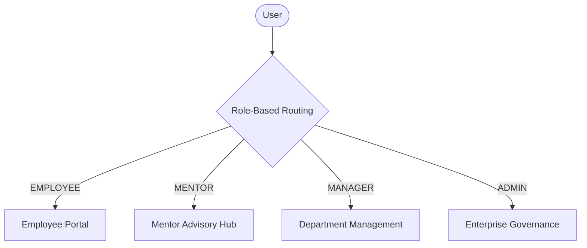
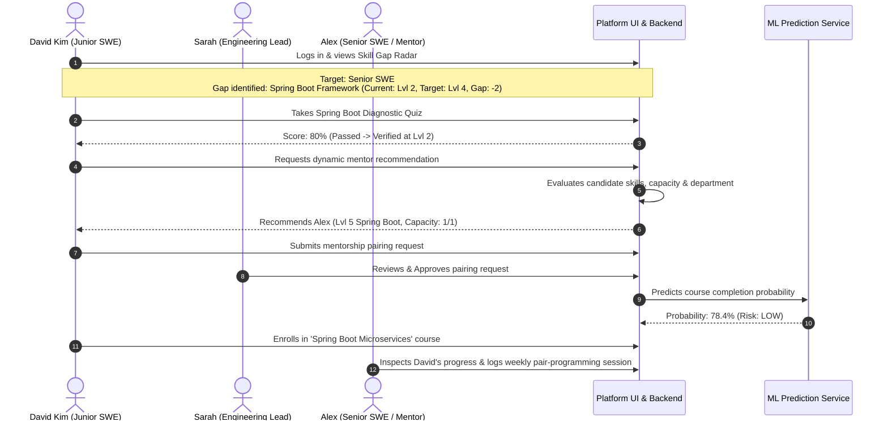

# Project Overview: Organizational Knowledge Gap Intelligence Platform

## 1. What Problem This Project Solves

In modern corporate environments, engineering and enterprise teams frequently encounter **competency misalignment**:
- Organizations do not know what technical skills their employees genuinely possess versus what they claim on a resume.
- Managers lack data-driven visibility into which specific technical skills their team lacks to deliver upcoming projects.
- Traditional Learning Management Systems (LMS) offer static course catalogs where employees randomly enroll in training without diagnostic proof that the course addresses their actual skill deficiencies.
- High-performing senior engineers are either underutilized as mentors or overwhelmed with arbitrary mentorship requests because there is no automated, capacity-aware matching system.
- Companies waste significant training budgets on employees who fail or drop out of courses because no predictive risk modeling is performed prior to enrollment.

The **Organizational Knowledge Gap Intelligence Platform** solves this by creating a closed-loop intelligence system that connects **objective competency evaluation, dynamic gap analysis, personalized learning roadmaps, capacity-constrained peer mentorship, and machine learning completion risk predictions**.

---

## 2. Why Organizations Need This Platform

Organizations deploy this platform to achieve five measurable operational outcomes:
1. **Eliminate Guesswork in Upskilling:** Replace subjective self-ratings with standardized diagnostic quizzes and manager-verified assessments.
2. **Targeted Career Progression:** Map employees from their current job role (e.g., *Junior Software Engineer*) to a target career role (e.g., *Senior Software Engineer*) by computing exact skill gaps against structured requirements.
3. **Optimized Mentorship Bandwidth:** Pair employees with verified internal subject-matter experts while enforcing weekly hour limits and mentee capacity rules so senior engineers are never overburdened.
4. **Predictive Training Risk Mitigation:** Run predictive models before course enrollment to identify at-risk learners and provide early intervention (such as mandatory mentor assignment or diagnostic prep).
5. **Auditable Talent Governance:** Maintain centralized identity, role-based access control, and department-level data isolation.

---

## 3. Who Uses the Platform (User Personas)

The platform supports **four distinct roles**:

1. **Employee (`ROLE_EMPLOYEE`):**
   - Self-reports baseline proficiencies across standard skills.
   - Takes interactive diagnostic quizzes to verify competency levels.
   - Views their personalized **Skill Gap Radar** and career readiness score.
   - Generates and follows a personalized **Learning Roadmap**.
   - Browses algorithmically ranked course recommendations.
   - Requests dynamic peer mentorship for specific gap skills.
2. **Mentor (`ROLE_MENTOR`):**
   - Dedicated expert advisors (e.g., Senior Engineers / Architects).
   - Manages weekly guidance availability and maximum mentee capacity.
   - Views assigned mentees and inspects their live learning pathways and quiz histories.
   - Logs 1-on-1 advisory sessions, agendas, and technical action items.
3. **Manager (`ROLE_MANAGER`):**
   - Monitors aggregate department and team skill coverage.
   - Reviews and approves or rejects employee mentorship pairings.
   - Inspects direct reports' skill gaps, quiz attempt scores, and learning progress.
4. **Administrator (`ROLE_ADMIN`):**
   - Manages enterprise identity, account activation/deactivation, and role assignments.
   - Manages standard course catalogs, skill taxonomies, and diagnostic quiz questions.
   - Monitors microservice infrastructure connectivity (PostgreSQL, Spring Boot, FastAPI ML service).

---

## 4. What "Organizational Knowledge Gaps" Mean

In this platform, a **Knowledge Gap** is defined mathematically and structurally:
- Every **Job Role** defines a set of required skills with a required proficiency level (scale 1 to 5) and an importance weight:
  - **Mandatory (Weight $\ge 3.0$):** Non-negotiable technical skills required for the role.
  - **Core (Weight $2.0 \le w < 3.0$):** Day-to-day functional proficiencies.
  - **Elective (Weight $< 2.0$):** Supplementary or secondary skills.
- An employee has a **Verified Proficiency Level** (1 to 5) obtained through manager sign-off or passing a diagnostic quiz.
- For each required skill $i$:
  $$\text{Raw Gap}_i = \max(0, \text{Required Level}_i - \text{Verified Level}_i)$$
  $$\text{Weighted Gap}_i = \text{Raw Gap}_i \times \text{Importance Weight}_i$$
- **Overall Readiness Percentage:**
  $$\text{Readiness \%} = \left( \frac{\sum \min(\text{Verified Level}_i, \text{Required Level}_i) \times w_i}{\sum \text{Required Level}_i \times w_i} \right) \times 100$$

A positive gap means the employee cannot yet execute target job responsibilities independently and requires targeted upskilling.

---

## 5. Real-World Walkthrough Example

Consider **David Kim**, a *Junior Software Engineer* at the organization whose target role is *Senior Software Engineer*.

1. **Identification:** David logs in and inspects his **Skill Gap Radar**. His current role is *Junior SWE*, but his target is *Senior SWE*. The platform flags a critical gap: **Spring Boot Framework** (Current: Level 2, Required: Level 4, Gap: 2, Importance: Mandatory 3.0).
2. **Verification:** David navigates to **Diagnostic Quizzes** and attempts the Spring Boot assessment. The backend securely checks his answers against the database, records his score (80%), and confirms his verified level.
3. **Roadmap & Recommendations:** David clicks **Learning Roadmap**. The engine generates a sequential curriculum with milestone courses specifically mapped to Spring Boot and Microservices.
4. **Mentorship Pairing:** David visits **Peer Mentorship**. The platform's matching engine detects his Spring Boot gap and dynamically recommends **Alex Vance** (a Senior Engineer with verified Level 5 proficiency in Spring Boot and active mentorship capacity).
5. **Manager Approval:** Engineering Manager **Sarah Jenkins** sees the pending recommendation on her **Mentor Approvals** dashboard. She inspects Alex's remaining capacity (1/1) and approves the pairing.
6. **ML Outcome Prediction:** Before David starts the course, the platform sends his profile features (baseline proficiency, gap magnitude, quiz score, weekly study hours, mentor flag) to the FastAPI ML service. The Random Forest model predicts a **78.4% success probability (Risk: LOW)**.
7. **Advisory Guidance:** Mentor Alex logs into the **Mentor Hub**, views David under assigned mentees, inspects his course progress, and logs their weekly 1-on-1 code architecture review.

---

## 6. Every Feature Currently Implemented in Source Code

The following capabilities are genuinely implemented in the repository across backend, database, ML service, and frontend:

| Subsystem | Feature | Source Verification | Status |
| :--- | :--- | :--- | :--- |
| **Authentication & RBAC** | JWT Stateless Authentication | `AuthController.java`, `JwtTokenProvider.java`, `AuthContext.jsx` | **Complete & Verified** |
| **Authentication & RBAC** | 4 Supported Roles: ADMIN, MANAGER, EMPLOYEE, MENTOR | `Role.java`, `V3__add_mentor_role.sql`, `App.jsx` | **Complete & Verified** |
| **Authentication & RBAC** | Departmental Data Isolation | `SecurityUtils.validateUserAccess()`, `@PreAuthorize` | **Complete & Verified** |
| **Skill Gap Engine** | Deterministic Weighted Skill Gap Calculation | `SkillGapService.java`, `SkillGapController.java` | **Complete & Verified** |
| **Skill Gap Engine** | Target Job Role Readiness Score (%) | `SkillGapReportDto.java`, `SkillGapRadarChart.jsx` | **Complete & Verified** |
| **Diagnostic Assessments** | Safe Quiz Delivery (answers hidden until submit) | `AssessmentController.java`, `AssessmentService.java` | **Complete & Verified** |
| **Diagnostic Assessments** | Dynamic Quiz Grading & Score Persistence | `AssessmentQuizPage.jsx`, `assessment_submissions` table | **Complete & Verified** |
| **Learning Pathways** | Personalized Roadmap Generation & Progress Tracking | `LearningPathService.java`, `LearningPathPage.jsx` | **Complete & Verified** |
| **Course Engine** | Gap-Driven Course Recommendations & Catalog | `CourseRecommendationService.java`, `CourseController.java` | **Complete & Verified** |
| **Mentorship** | Capacity-Constrained Mentor Matching Algorithm | `MentorMatchingService.java`, `employee_profiles` table | **Complete & Verified** |
| **Mentorship** | Manager Approval/Rejection Workflow | `MentorApprovalPage.jsx`, `MentorAssignmentService.java` | **Complete & Verified** |
| **Mentorship** | Dedicated Mentor Advisory Dashboard | `MentorDashboard.jsx`, `mentorshipApi.js` | **Complete & Verified** |
| **Mentorship** | 1-on-1 Advisory Session Logging | `MentorDashboard.jsx` (local persistence per assignment) | **Complete & Verified** |
| **Machine Learning** | Training Outcome & Risk Prediction Microservice | `ml-service/src/service.py`, `RandomForestClassifier` | **Complete & Verified** |
| **Machine Learning** | Spring Boot ML Integration Client | `MlPredictionService.java` (REST client via port 8000) | **Complete & Verified** |
| **Administration** | User Directory, Role Provisioning & Status Toggles | `UserManagementPage.jsx`, `AdminUserController.java` | **Complete & Verified** |
| **Administration** | Catalog Management (Courses & Quiz Questions) | `CatalogsPage.jsx`, `CourseRepository.java` | **Complete & Verified** |
| **UI Aesthetics** | Dark Glassmorphism, Responsive Nav, Role Badges | `index.css`, `Navbar.jsx`, `Sidebar.jsx` | **Complete & Verified** |

---

## 7. Incomplete, Mocked, Synthetic, or Non-Backend Features

To uphold absolute transparency, here are features that are **synthetic, partially mocked, or client-side**:

1. **ML Training Dataset Provenance:**
   - The ML service's Random Forest model is trained on a **synthetic development dataset** (`ml-service/data/synthetic_training_outcomes_dev.csv`, 1,200 rows) generated using mathematical distributions in `data_generator.py`.
   - **Reason:** Real-world enterprise completion logs require months of production runtime to accumulate.
   - **Status:** The ML model itself is 100% genuine scikit-learn code; only the training data is synthetically generated for local development.
2. **Mentorship Sessions Persistence:**
   - Mentorship pairings (`mentor_assignments`) are fully persisted in PostgreSQL with status, mentor/mentee IDs, and notes.
   - Individual session logs (meeting agenda, duration in minutes, discussion notes) in `MentorDashboard.jsx` are currently persisted in browser `localStorage` keyed by assignment ID, rather than a separate database `mentorship_sessions` table.
3. **Live Video / WebRTC:**
   - The platform tracks mentorship availability and schedules advisory sessions, but video calling or instant messaging is not implemented (users use standard external tools like Teams or Slack).
4. **Course Content Player:**
   - Courses have titles, descriptions, durations, and skill gain mappings in the catalog, but the platform is an **intelligence and orchestration layer**, not a streaming video host. External course links (`url` field) point to external LMS or enterprise providers.
