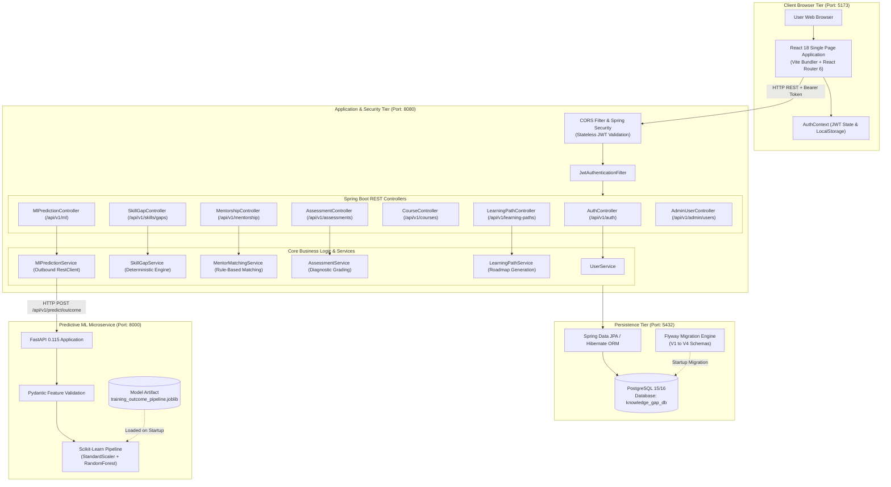
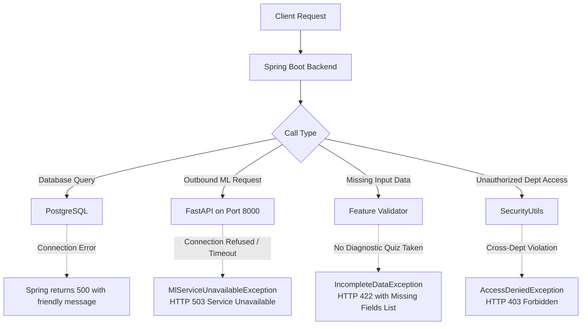

# System Architecture & Component Interaction Guide

This document explains the technical architecture of the **Organizational Knowledge Gap Intelligence Platform**, illustrating the end-to-end flow of data across the user's browser, React frontend, Spring Boot REST backend, PostgreSQL database, and Python FastAPI machine learning microservice.

---

## 1. High-Level Architecture Diagram

---

## 2. Detailed End-to-End Component Breakdown

### Tier 1: Client / Web Browser (`http://localhost:5173`)
1. **User Interaction:**
   The user accesses the platform via any standard web browser. The application is a Single Page Application (SPA) served by Vite on port `5173`.
2. **State Management (`AuthContext.jsx`):**
   - Stores the signed JWT string and current user object in browser memory and mirrors it to `localStorage`.
   - Exposes boolean role helpers (`isAdmin`, `isManager`, `isEmployee`, `isMentor`).
3. **Route Protection (`App.jsx`):**
   - `<ProtectedRoute>` checks if the visitor is authenticated. If not, it redirects them to `/login`.
   - `<RoleDashboardRouter>` dynamically displays the correct dashboard:
     - `ADMIN` $\rightarrow$ [AdminDashboard.jsx](file:///d:/Rep/frontend/src/pages/admin/AdminDashboard.jsx)
     - `MANAGER` $\rightarrow$ [ManagerDashboard.jsx](file:///d:/Rep/frontend/src/pages/manager/ManagerDashboard.jsx)
     - `MENTOR` $\rightarrow$ [MentorDashboard.jsx](file:///d:/Rep/frontend/src/pages/mentor/MentorDashboard.jsx)
     - `EMPLOYEE` $\rightarrow$ [EmployeeDashboard.jsx](file:///d:/Rep/frontend/src/pages/employee/EmployeeDashboard.jsx)
4. **API Client (`api/client.js`):**
   - An Axios instance intercepts every outbound request, reading `localStorage.getItem('token')` and appending the header:
     `Authorization: Bearer <token>`
   - Intercepts 401 Unauthorized responses to clear stale sessions and redirect to `/login?expired=true`.

---

### Tier 2: Backend Application & Security Tier (`http://localhost:8080`)
1. **CORS & CSRF:**
   - [SecurityConfig.java](file:///d:/Rep/backend/src/main/java/com/orgkgi/config/SecurityConfig.java) permits requests from `http://localhost:5173`.
   - CSRF is disabled because authentication is completely stateless via JWT Bearer tokens.
2. **JWT Filter (`JwtAuthenticationFilter.java`):**
   - Intercepts incoming HTTP requests.
   - Parses the `Authorization: Bearer <token>` header.
   - Validates the digital signature against the 256-bit HMAC secret in `application.yml`.
   - Extracts the user's email and role, loading the principal into Spring's `SecurityContextHolder`.
3. **Role-Based Authorization:**
   - Endpoints are annotated with `@PreAuthorize("hasRole('ADMIN')")`, `@PreAuthorize("hasAnyRole('MANAGER', 'ADMIN')")`, or `@PreAuthorize("hasAnyRole('MANAGER', 'ADMIN', 'MENTOR')")`.
   - [SecurityUtils.java](file:///d:/Rep/backend/src/main/java/com/orgkgi/security/SecurityUtils.java) provides fine-grained departmental boundary validation:
     - Admins can access all records.
     - Managers can only access employees in their department.
     - Mentors can access assigned mentees or employees in their department.
     - Employees can only view their own profile.
4. **Service Engines:**
   - **Skill Gap Service:** Evaluates required skills for the target job role against employee verified skills.
   - **Mentor Matching Service:** Finds active mentor candidates whose capacity is not full and who possess verified skills matching the employee's deficits.
   - **Assessment Service:** Delivers quizzes without answers, grades submissions, and updates skill verification status in PostgreSQL.
   - **Learning Path Service:** Generates ordered curriculum pathways matching unverified skills.

---

### Tier 3: Persistence Tier (`localhost:5432 / PostgreSQL`)
1. **Flyway Migrations:**
   On backend startup, Flyway checks the `flyway_schema_history` table and executes pending migration scripts in order:
   - `V1__init_schema.sql`: Core tables, constraints, foreign keys, indexes.
   - `V2__seed_dev_data.sql`: Seed departments, job roles, skills, courses, assessments, and users with encrypted passwords (`Password@123`).
   - `V3__add_mentor_role.sql`: Adds `MENTOR` to check constraint, seeds Mentor Alex, verified skills, and active pairing with David Kim.
   - `V4__update_mentor_profile_capacity.sql`: Configures active mentor capacity.
2. **Data Consistency:**
   Managed via Spring Data JPA repositories with `@Transactional` boundaries.

---

### Tier 4: Machine Learning Microservice (`http://localhost:8000`)
1. **Architecture & Connection:**
   The ML microservice is an independent Python FastAPI process running on port `8000`.
   **Spring Boot communicates with FastAPI over HTTP REST**:
   `Spring Boot (MlPredictionService) ---> POST http://localhost:8000/api/v1/predict/outcome ---> FastAPI`
2. **Feature Extraction in Spring Boot:**
   The backend pulls authentic features from PostgreSQL:
   - Baseline proficiency average (from verified skills).
   - Weighted skill gap magnitude (from target job role requirements).
   - Historical course completion rate (from past learning paths).
   - Diagnostic assessment score (from latest quiz submission).
   - Dedicated weekly study hours.
   - Course difficulty level (numeric 1 to 3).
   - Mentor assignment status (binary 0 or 1).
   - Employee tenure in months.
3. **Inference in FastAPI:**
   - FastAPI validates inputs using Pydantic (`TrainingOutcomePredictionRequest`).
   - The features are passed through the pre-loaded Scikit-Learn pipeline (`StandardScaler` + `RandomForestClassifier`).
   - The model outputs:
     - `predicted_outcome`: `"SUCCESS"` or `"AT_RISK"`
     - `success_probability`: float between 0.0 and 1.0 (e.g. `0.784`)
     - `risk_level`: `"LOW"`, `"MEDIUM"`, or `"HIGH"`
4. **Persistence of Predictions:**
   Spring Boot receives the response and persists the record into the `training_predictions` table in PostgreSQL, linking it to the employee profile and learning path.

---

## 3. Communication Protocols and Port Mapping

| Service | Technology | Port | Accessible By | Primary Endpoints |
| :--- | :--- | :--- | :--- | :--- |
| **Frontend UI** | React + Vite | `5173` | End Users (Browser) | `http://localhost:5173` |
| **Backend REST API** | Spring Boot | `8080` | Frontend UI / Swagger | `http://localhost:8080/api/v1/*` |
| **API Documentation** | Swagger UI | `8080` | Developers / Admins | `http://localhost:8080/swagger-ui.html` |
| **Database** | PostgreSQL | `5432` | Spring Boot (JDBC) | `jdbc:postgresql://localhost:5432/knowledge_gap_db` |
| **ML Microservice** | FastAPI + Uvicorn | `8000` | Spring Boot (RestClient) | `http://localhost:8000/api/v1/predict/outcome` |
| **ML Documentation** | FastAPI Swagger | `8000` | Data Scientists / Devs | `http://localhost:8000/docs` |

---

## 4. Error Handling and Fault Tolerance

1. **ML Service Outage:**
   If the Python ML microservice is stopped or unreachable, `MlPredictionService.java` catches the `ResourceAccessException` and throws `MlServiceUnavailableException` (HTTP 503). The frontend displays an informative banner informing the employee that diagnostic baseline data is required or the ML service is offline, without crashing the application.
2. **Incomplete Employee Data:**
   If an employee has never taken a diagnostic quiz or has no hire date, Spring Boot throws `IncompleteDataException` (HTTP 422) listing the exact missing fields required for ML modeling.
3. **Session Expiration:**
   If a JWT token expires (default 24 hours), Spring Security's `JwtAuthenticationEntryPoint` responds with HTTP 401. The Axios response interceptor automatically removes the invalid token from `localStorage` and redirects the user to `/login?expired=true`.
