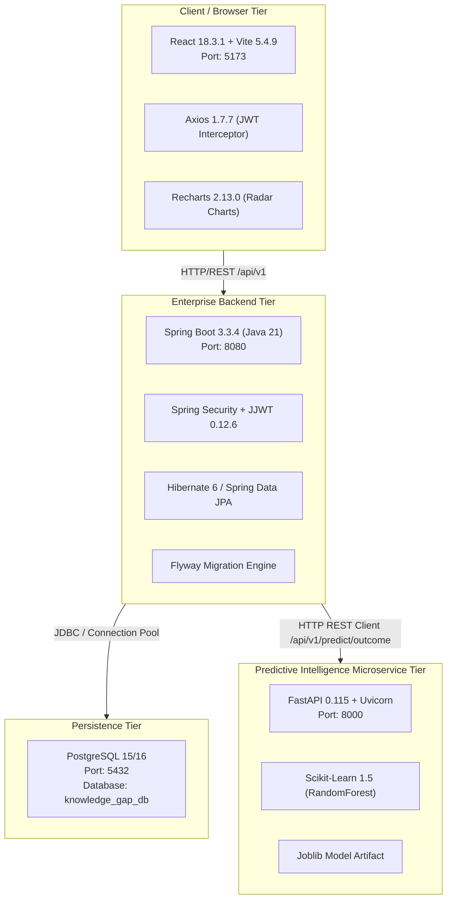

# Technology Stack Reference

This document provides a comprehensive, verified audit of every technology, language, framework, database engine, microservice tool, and library utilized in the **Organizational Knowledge Gap Intelligence Platform**.

All versions and configurations documented below have been verified against active workspace files: [pom.xml](file:///d:/Rep/backend/pom.xml), [package.json](file:///d:/Rep/frontend/package.json), [requirements.txt](file:///d:/Rep/ml-service/requirements.txt), and [application.yml](file:///d:/Rep/backend/src/main/resources/application.yml).

---

## 1. Architecture Overview by Layer

---

## 2. Frontend Technology Stack

### 2.1 React (v18.3.1)
- **What it is:** A declarative, component-based JavaScript library for building single-page user interfaces.
- **Why this project uses it:** Provides fast, reactive state updates for complex multi-role dashboards (Employee, Mentor, Manager, Admin) without full-page browser reloads. Uses modern React Hooks (`useState`, `useEffect`, `useContext`, `useNavigate`).
- **Where it appears:** `frontend/src/main.jsx`, `frontend/src/App.jsx`, `frontend/src/context/AuthContext.jsx`, and all page components in `frontend/src/pages/`.
- **How it communicates:** Renders virtual DOM nodes in the browser, maintains authentication state in context, and dispatches asynchronous requests to backend APIs via Axios.

### 2.2 Vite (v5.4.9)
- **What it is:** A next-generation frontend development server and bundler powered by Rollup and native ES modules.
- **Why this project uses it:** Instant server start, lightning-fast Hot Module Replacement (HMR) during development, and optimized production chunking (`npm run build`).
- **Where it appears:** `frontend/vite.config.js`, `frontend/package.json`.
- **How it communicates:** Serves the frontend at `http://localhost:5173` and provides a dev proxy redirecting `/api` requests to the Spring Boot backend at `http://localhost:8080`.

### 2.3 React Router DOM (v6.27.0)
- **What it is:** The standard routing library for React applications.
- **Why this project uses it:** Provides client-side declarative routing, URL path synchronization, and conditional route guards (`<ProtectedRoute>`).
- **Where it appears:** `frontend/src/App.jsx`, `frontend/src/components/common/Sidebar.jsx`.
- **How it communicates:** Intercepts browser history navigation, inspects the current user's role from `AuthContext`, and renders the appropriate role dashboard or redirects unauthenticated visitors to `/login` or unauthorized users to `/unauthorized`.

### 2.4 Axios (v1.7.7)
- **What it is:** A promise-based HTTP client for browser and Node.js.
- **Why this project uses it:** Supports global instance configuration, automatic JSON parsing, request interceptors (for injecting Bearer JWT tokens), and response interceptors (for handling 401 session expiration).
- **Where it appears:** `frontend/src/api/client.js`, `frontend/src/api/*.js`.
- **How it communicates:** Sends HTTP `GET`, `POST`, `PUT`, and `PATCH` requests to the Spring Boot REST API (`/api/v1/...`).

### 2.5 Recharts (v2.13.0)
- **What it is:** A composable charting library built on React components and SVG.
- **Why this project uses it:** Visualizes multi-dimensional skill gap assessments using interactive Radar Charts comparing employee current verified proficiency against target role requirements.
- **Where it appears:** `frontend/src/components/charts/SkillGapRadarChart.jsx`, `frontend/src/pages/employee/SkillGapPage.jsx`.
- **How it communicates:** Receives structured JSON arrays from `skillGapApi.getOwnSkillGaps()` and translates numeric levels into SVG polar coordinates.

### 2.6 Lucide React (v0.453.0)
- **What it is:** A lightweight, customizable icon library with modern, clean aesthetics.
- **Why this project uses it:** Provides consistent iconography across all four workspaces without heavy SVG asset overhead.
- **Where it appears:** `Navbar.jsx`, `Sidebar.jsx`, `StatCard.jsx`, `MentorDashboard.jsx`.

### 2.7 Vanilla CSS & Design System
- **What it is:** Pure CSS with customized CSS variables, glassmorphism (`backdrop-filter: blur`), dark-mode palettes, and CSS Grid.
- **Why this project uses it:** Avoids brittle Tailwind build issues; delivers high-performance, tailored enterprise dark-mode aesthetics.
- **Where it appears:** `frontend/src/index.css`.

---

## 3. Backend Technology Stack

### 3.1 Java 21 (LTS)
- **What it is:** The Long-Term Support release of the Java programming platform.
- **Why this project uses it:** High performance, modern language features (pattern matching, records, streamlined collections), and long-term stability.
- **Where it appears:** `backend/pom.xml` (`<java.version>21</java.version>`).

### 3.2 Spring Boot (v3.3.4)
- **What it is:** An enterprise-grade, opinionated microservice and web framework.
- **Why this project uses it:** Provides dependency injection, auto-configuration, robust transaction management (`@Transactional`), and production-ready monitoring.
- **Where it appears:** `backend/pom.xml`, `backend/src/main/java/com/orgkgi/KnowledgeGapPlatformApplication.java`.
- **How it communicates:** Runs an embedded Tomcat server on port `8080`, hosting RESTful endpoints under `/api/v1/*`.

### 3.3 Spring Security (v6.3 / Boot 3.3.4)
- **What it is:** A comprehensive authentication and access-control framework.
- **Why this project uses it:** Enforces stateless session management, CSRF protection rules, method-level authorization (`@PreAuthorize`), and role-based access control.
- **Where it appears:** `backend/src/main/java/com/orgkgi/config/SecurityConfig.java`, `backend/src/main/java/com/orgkgi/security/*`.
- **How it communicates:** Positioned in front of all incoming HTTP requests via `JwtAuthenticationFilter`, extracting the Bearer token and populating the Spring `SecurityContext`.

### 3.4 JJWT (io.jsonwebtoken v0.12.6)
- **What it is:** A pure Java library for creating, signing, and verifying JSON Web Tokens (JWT).
- **Why this project uses it:** Generates HMAC-SHA256 digitally signed tokens containing user ID, email, and authority roles.
- **Where it appears:** `backend/src/main/java/com/orgkgi/security/JwtTokenProvider.java`.
- **How it communicates:** Signs the JWT using the 256-bit secret from `application.yml` during login; validates signatures on every subsequent API call.

### 3.5 Spring Data JPA & Hibernate ORM
- **What it is:** Object-Relational Mapping (ORM) and repository abstraction over relational databases.
- **Why this project uses it:** Maps PostgreSQL tables to Java POJO entities; generates optimized SQL queries; provides transactional integrity.
- **Where it appears:** `backend/src/main/java/com/orgkgi/entity/*`, `backend/src/main/java/com/orgkgi/repository/*`.
- **How it communicates:** Translates entity operations into SQL statements executed through the HikariCP connection pool to PostgreSQL.

### 3.6 Flyway Migration Engine (v10.x / Boot 3.3.4)
- **What it is:** An open-source database migration and version control tool.
- **Why this project uses it:** Guarantees deterministic, reproducible schema creation and data seeding across all environments without manual SQL script execution.
- **Where it appears:** `backend/src/main/resources/db/migration/V1__init_schema.sql` through `V4__update_mentor_profile_capacity.sql`.
- **How it communicates:** Runs automatically on Spring Boot application startup before Hibernate validation begins.

### 3.7 SpringDoc OpenAPI (v2.6.0)
- **What it is:** Automated OpenAPI 3.0 specification generator for Spring Boot.
- **Why this project uses it:** Produces interactive Swagger UI documentation for all REST endpoints with JWT authorization support.
- **Where it appears:** Accessible at `http://localhost:8080/swagger-ui.html`.

### 3.8 Spring RestClient
- **What it is:** The modern, synchronous HTTP client introduced in Spring 6 / Spring Boot 3.
- **Why this project uses it:** Performs robust, non-blocking outbound HTTP calls to the FastAPI machine learning service with connection timeouts.
- **Where it appears:** `backend/src/main/java/com/orgkgi/service/MlPredictionService.java`.
- **How it communicates:** Serializes feature payloads to JSON and dispatches POST requests to `http://localhost:8000/api/v1/predict/outcome`.

---

## 4. Database Technology Stack

### 4.1 PostgreSQL (v15 / 16)
- **What it is:** An advanced, open-source object-relational database management system.
- **Why this project uses it:** ACID compliance, native JSONB support (used for storing assessment multiple-choice questions), foreign-key relational integrity, and robust check constraints.
- **Where it appears:** `backend/src/main/resources/application.yml`, `docker-compose.yml`.
- **Connection Details:**
  - Port: `5432`
  - Database Name: `knowledge_gap_db`
  - Default User: `postgres`
  - Tables: 15 normalized tables across 4 migrations.

---

## 5. Machine Learning Microservice Stack

### 5.1 Python (v3.10 / 3.11 / 3.12)
- **What it is:** The industry standard programming language for data science and machine learning.
- **Why this project uses it:** Direct access to scikit-learn, pandas, numpy, and asynchronous web frameworks.
- **Where it appears:** `ml-service/src/*.py`.

### 5.2 FastAPI (v0.115.0)
- **What it is:** A modern, high-performance web framework for building APIs with Python based on standard Python type hints.
- **Why this project uses it:** Sub-millisecond response latency, automatic Pydantic request validation, and built-in OpenAPI documentation.
- **Where it appears:** `ml-service/main.py`.
- **How it communicates:** Runs on `http://localhost:8000`, accepting JSON payloads from the Spring Boot backend.

### 5.3 Scikit-Learn (v1.5.0)
- **What it is:** The primary Python library for classical machine learning and data modeling.
- **Why this project uses it:** Trains, evaluates, and serves the `RandomForestClassifier` and baseline `LogisticRegression` models for employee course completion predictions.
- **Where it appears:** `ml-service/src/train.py`, `ml-service/src/service.py`.

### 5.4 Pandas (v2.2.0) & NumPy (v2.0.0)
- **What it is:** High-performance data manipulation and numeric array computation libraries.
- **Why this project uses it:** Generates synthetic development distributions, structures training matrices, and normalizes feature vectors.
- **Where it appears:** `ml-service/src/data_generator.py`, `ml-service/src/train.py`.

### 5.5 Joblib (v1.4.0)
- **What it is:** A set of tools to provide lightweight pipelining and disk serialization of Python objects.
- **Why this project uses it:** Serializes the trained scikit-learn pipeline to disk (`ml-service/model/training_outcome_pipeline.joblib`) for zero-overhead inference at runtime.

### 5.6 Pydantic (v2.9.0)
- **What it is:** Data validation and settings management using Python type annotations.
- **Why this project uses it:** Strictly validates that all 8 training features fall within acceptable ranges (e.g., `baseline_proficiency_avg` between 1.0 and 5.0).
- **Where it appears:** `ml-service/src/schemas.py`.

---

## 6. Testing & Quality Assurance Stack

| Component | Framework | Version | File Locations | Purpose |
| :--- | :--- | :--- | :--- | :--- |
| **Backend Integration Tests** | JUnit 5 | 5.10.3 | `backend/src/test/java/com/orgkgi/*` | Tests Spring Boot context, JPA repositories, Flyway migrations, and REST controllers. |
| **Backend Mocking** | Mockito | 5.11.0 | `backend/src/test/java/com/orgkgi/*` | Mocks service dependencies and repositories. |
| **Backend Security Tests** | Spring Security Test | 6.3.3 | `SecurityAuthorizationTest.java` | Tests 401/403 guards, role boundaries, and JWT token claims. |
| **Frontend Unit Tests** | Vitest | 2.1.0 | `frontend/src/test/*` | Fast Vite-native unit and integration test runner. |
| **Frontend DOM Testing** | React Testing Library | 16.3.3 | `frontend/src/test/*` | Simulates user interactions (clicks, form inputs, route changes). |
| **DOM Environment** | jsdom | 29.1.1 | `frontend/src/setupTests.js` | Headless browser environment for executing tests in Node.js. |
| **ML Service Tests** | Pytest | 8.0.0+ | `ml-service/tests/*` | Validates FastAPI endpoints, model loading, and feature bounds. |
